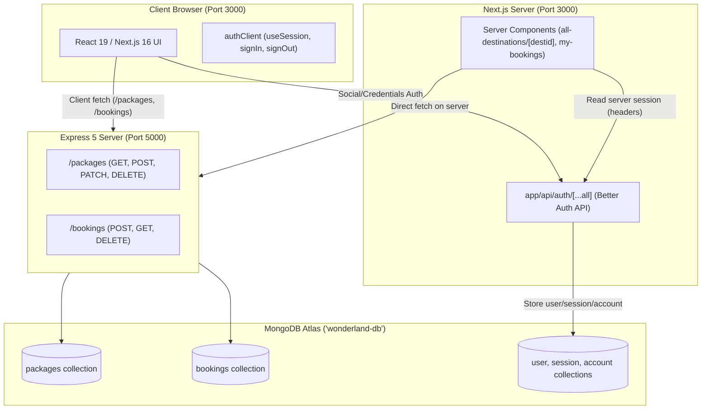
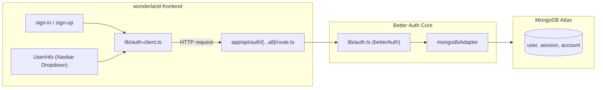

# Wanderlust (WonderLand) — Comprehensive Architecture & Developer Reference Guide

> **Core Philosophy**: **WHAT, WHERE, and WHY?**  
> This note page provides a complete, page-by-page, part-by-part breakdown of the entire WonderLand project spanning both **Frontend (Next.js 16 + React 19)** and **Backend (Express 5 + MongoDB Atlas)**.

---

## 1. High-Level Project Structure

```text
Module-46-WonderLand-project-frontend-and-backend/
├── wonderland-backend/             # Express 5 REST API + MongoDB Driver
│   ├── .env                        # MONGODB_URI, PORT
│   ├── index.js                    # Server entry: middleware, MongoDB client, all endpoints
│   ├── package.json                # "type": "module" (ESM), dependencies
│   └── package-lock.json
│
├── wonderland-frontend/            # Next.js 16 App Router + Tailwind v4 + shadcn/ui
│   ├── .env                        # BETTER_AUTH_SECRET, GOOGLE/GITHUB OAuth credentials
│   ├── next.config.ts              # Remote pattern image whitelist
│   ├── package.json                # Dependencies: Next 16, React 19, Better Auth, Lucide
│   ├── tsconfig.json               # Path alias: "@/*" -> "./*"
│   │
│   ├── app/                        # Next.js 16 App Router directory
│   │   ├── globals.css             # Tailwind v4 CSS-first config & OKLCH color system
│   │   ├── layout.tsx              # Root HTML shell, fonts, ThemeProvider, Toaster, Navbar, Footer
│   │   ├── page.tsx                # Homepage composed of Landing sections
│   │   │
│   │   ├── (auth)/                 # Route Group: Authentication & User Menu
│   │   │   ├── UserInfo.tsx        # Client dropdown menu with session status & sign-out
│   │   │   ├── sign-in/page.tsx    # Email & password login + Social OAuth (Google, GitHub)
│   │   │   └── sign-up/page.tsx    # Registration with client-side regex validations
│   │   │
│   │   ├── (pages)/                # Route Group: Main application features
│   │   │   ├── add-destination/    # Create new tour package (POST to backend)
│   │   │   │   └── page.tsx
│   │   │   ├── all-destinations/   # Browse, filter, search, & sort packages
│   │   │   │   ├── page.tsx        # Client catalog with multi-filter & sorting
│   │   │   │   └── [destid]/       # Dynamic Route: Destination detail page
│   │   │   │       ├── page.tsx    # Async Server Component (params promise, server fetch)
│   │   │   │       └── destination-actions.tsx # Client wrapper for edit/delete buttons
│   │   │   └── my-bookings/        # Authenticated user booking history
│   │   │       └── page.tsx        # Async Server Component with SSR session check
│   │   │
│   │   └── api/auth/[...all]/      # Better-Auth catch-all API route handler
│   │       └── route.ts            # toNextJsHandler(auth) for GET & POST
│   │
│   ├── components/                 # Reusable UI & Feature components
│   │   ├── Navbar.tsx              # Top navigation bar with active links & UserInfo
│   │   ├── Footer.tsx              # Multi-column footer with social links & legal links
│   │   ├── Banner.tsx              # Hero section with search bar and overlay
│   │   ├── WhyChooseUs.tsx         # Value propositions with custom icons
│   │   ├── Testimonials.tsx        # Embla carousel review slider
│   │   ├── CTA.tsx                 # Full-width call-to-action banner
│   │   ├── BookingCard.tsx         # Trip booking aside form with date picker & duplicate check
│   │   ├── MyBookingCard.tsx       # Booking item card with status badge & cancel confirmation
│   │   ├── UpdateDestination.tsx   # Dialog modal to edit an existing package (PATCH)
│   │   ├── DeleteDestination.tsx   # AlertDialog modal to delete a package (DELETE)
│   │   ├── remote-image.tsx        # Next/image wrapper with fallback for broken URLs
│   │   ├── social-sign-in-buttons.tsx # Google & GitHub OAuth triggers
│   │   ├── theme-provider.tsx      # next-themes wrapper + 'd' key hotkey listener
│   │   └── ui/                     # shadcn/ui primitives (button, dialog, select, etc.)
│   │
│   ├── lib/
│   │   ├── auth.ts                 # Better Auth server configuration with MongoDB adapter
│   │   ├── auth-client.ts          # Better Auth React client hooks (signIn, signOut, useSession)
│   │   └── utils.ts                # Class merging utility (cn)
│   │
│   └── assets/                     # Static design assets and local PNG images
```

---

## 2. Architectural Questions: The "What, Where, Why"



| Question | Answer |
|---|---|
| **What is this architecture?** | A decoupled full-stack architecture: Next.js 16 App Router handles the frontend and authentication sessions via Better Auth, while Express 5 handles backend business logic and raw CRUD data persistence. |
| **Where do they communicate?** | Frontend sends HTTP requests to `http://localhost:5000` via JSON payloads. Backend enables CORS specifically for `http://localhost:3000`. |
| **Why not put everything inside Next.js API routes?** | Separation of concerns: Express 5 provides an isolated, standard REST API service that can independently scale, be reused by mobile apps, and cleanly demonstrates Node.js backend concepts (Express middleware, CORS, MongoDB driver). |
| **Why Next.js 16 App Router?** | Enables React Server Components (RSC) for zero-bundle-size initial page loads, streaming UI, built-in SEO with metadata, and modern layouts without needing React Router. |

---

## 3. Backend Deep Dive (`wonderland-backend/index.js`)

### What It Does
An Express 5 server operating as an ESM module (`"type": "module"`), connecting to MongoDB Atlas via the official `mongodb` client, exposing RESTful endpoints for travel packages and trip bookings.

### Where
File: `wonderland-backend/index.js`  
Port: `5000` (via `process.env.port || 5000`)

### Key Logic & Methods
```javascript
// Top-Level Await connection pattern
const client = new MongoClient(process.env.MONGODB_URI);
export async function connectToMongoDB() {
  await client.connect();
  return client;
}
const connectedClient = await connectToMongoDB();
const database = connectedClient.db("wonderland-db");
const packages = database.collection("packages");
const bookingCollections = database.collection("bookings");
```

### Endpoints Reference Matrix

| Method | Endpoint | Purpose | Database Operation | Key Logic / Gotchas |
|---|---|---|---|---|
| `GET` | `/` | Health check | None | Verifies server is online |
| `POST` | `/add-package` | Add a new tour package | `packages.insertOne(newPackage)` | Reads `req.body`, returns inserted ID |
| `GET` | `/packages` | Retrieve all tour packages | `packages.find({}).toArray()` | Returns array of all destinations |
| `GET` | `/packages/:id` | Retrieve single destination details | `packages.findOne({ _id: new ObjectId(id) })` | Requires valid 24-character hex string for `ObjectId` |
| `PATCH` | `/packages/:id` | Update package fields | `packages.updateOne({ _id: new ObjectId(id) }, { $set: updatedPackage })` | Uses `$set` operator to modify only passed fields without overwriting the entire document |
| `DELETE` | `/packages/:id` | Delete single destination | `packages.deleteOne({ _id: new ObjectId(id) })` | Deletes travel package document |
| `POST` | `/bookings` | Book a travel tour | `bookingCollections.insertOne(data)` | Stores user info, departure date, and package reference |
| `GET` | `/bookings/:email` | Get user's booked trips | `bookingCollections.find({ email }).toArray()` | Finds all bookings matching authenticated user's email |
| `DELETE` | `/my-bookings/:id` | Cancel/delete a booking | `bookingCollections.deleteOne({ _id: new ObjectId(id) })` | Removes the booking document by its own `_id` |

### Why Built This Way?
- **Top-Level Await**: Supported natively in modern Node.js ESM. It blocks server execution until database connectivity is verified, preventing queries from executing before MongoDB is ready.
- **`ObjectId(id)` Conversion**: MongoDB generates BSON 12-byte `ObjectId` primary keys. String IDs from `req.params.id` must be wrapped in `new ObjectId(id)` to query the database.
- **PATCH vs PUT**: `PATCH` allows partial updates using `$set`, preventing unintentional erasing of fields not included in the payload.

---

## 4. Frontend Page-by-Page, Part-by-Part Breakdown

### Part 1: Global App Shell & Foundations

#### 1.1 `app/globals.css` (Tailwind CSS v4 & Styling Engine)
- **WHAT**: Global stylesheet configuring Tailwind CSS v4, theme tokens, and the OKLCH design palette.
- **WHERE**: `app/globals.css`, imported in `app/layout.tsx`.
- **WHY**:
  - Tailwind v4 uses CSS-first configuration: no `tailwind.config.js` is needed.
  - `@custom-variant dark (&:is(.dark *));`: Enables custom dark mode variants compatible with shadcn/ui.
  - `@theme inline { ... }`: Maps CSS variables into Tailwind utility classes (e.g., `bg-background`, `text-primary`).
  - **OKLCH Color Space**: Provides perceptually uniform lightness across devices, resulting in accessible contrast in both light and dark modes.

#### 1.2 `app/layout.tsx` (Root Layout)
- **WHAT**: The root HTML shell wrapping every page in the application.
- **WHERE**: `app/layout.tsx`.
- **KEY LOGICS & HOOKS**:
  - **Font Optimization**: `Geist` and `Geist_Mono` loaded via `next/font/google` with CSS variables `--font-sans` and `--font-mono`.
  - **`suppressHydrationWarning`**: Added on `<html>` to prevent hydration mismatch errors when `next-themes` modifies the HTML `class` attribute during client-side hydration.
  - **Provider Hierarchy**:
    ```tsx
    <html lang="en" suppressHydrationWarning className={cn("antialiased", ...)}>
      <body>
        <Navbar />
        <ThemeProvider>{children}</ThemeProvider>
        <Toaster position="top-right" />
        <Footer />
      </body>
    </html>
    ```
- **WHY**:
  - Having `Navbar`, `Footer`, and `Toaster` in `RootLayout` guarantees persistent UI and global toasts across all route transitions without re-mounting.

#### 1.3 `components/theme-provider.tsx` (Dark Mode & Hotkey Listener)
- **WHAT**: Wrapper around `next-themes` with a custom keyboard shortcut listener.
- **WHERE**: `components/theme-provider.tsx`.
- **KEY LOGIC**:
  - Listens for the `d` key press on `window` to toggle between `"light"` and `"dark"`.
  - **Input Guard**: Helper `isTypingTarget(target)` checks if the target is an `INPUT`, `TEXTAREA`, `SELECT`, or `isContentEditable`. If the user is typing a word containing "d", the hotkey is ignored.
- **WHY**: Delivers developer and power-user convenience while avoiding accidental theme flips during form inputs.

---

### Part 2: Landing Page (`app/page.tsx`)

#### 2.1 Composition
```tsx
export default function Page() {
  return (
    <>
      <Banner />
      <WhyChooseUs />
      <Testimonials />
      <CTA />
    </>
  )
}
```
- **WHAT**: Server Component assembling the high-converting marketing landing page.
- **WHERE**: `app/page.tsx` (`/`).
- **WHY**: Rendered as a React Server Component by default, ensuring fast First Contentful Paint (FCP) and optimal SEO.

#### 2.2 Section Components Breakdown

| Component | Type | Key CSS / Styling | Logic / React Features |
|---|---|---|---|
| **`Banner.tsx`** | Server Component | `min-h-[85vh]`, `backdrop-blur-md`, `bg-white/20`, `z-10` overlay | Static image import `bannerImage` passed to `next/image` with `priority` attribute for Largest Contentful Paint (LCP) optimization. Rendered with simulated search criteria grid. |
| **`WhyChooseUs.tsx`** | Server Component | `bg-gradient-to-b from-cyan-50 to-white`, `border-teal-200`, `md:grid-cols-3` | Maps through static features list (Safe & Secure, Expert Guides, 24/7 Support) with localized icon assets. |
| **`Testimonials.tsx`** | Client Component (`"use client"`) | Responsive card grid with carousel container, `size-10 rounded-full border` | Integrates `embla-carousel-react` via shadcn Carousel (`CarouselContent`, `CarouselItem`, `CarouselPrevious`, `CarouselNext`). Client-rendered to allow smooth swipe and drag events. |
| **`CTA.tsx`** | Server Component | `bg-[#0d0d0d]`, `rounded-3xl overflow-hidden`, `min-h-96` | High-contrast dark call-to-action banner inviting users to book their trips. |

---

### Part 3: All Destinations Catalog (`app/(pages)/all-destinations/page.tsx`)

#### What
An interactive, client-side searchable, filterable, and sortable directory of all available travel packages.

#### Where
Route: `/all-destinations`  
File: `app/(pages)/all-destinations/page.tsx`

#### Why Client Component?
Marked with `"use client"` because it handles continuous user interaction: dynamic dropdown changes, client-side sorting, responsive re-filtering, and manual reload retries.

#### Core States & Hooks
- `destinations`: Array of `Destination` objects fetched from `http://localhost:5000/packages`.
- `loading` & `loadError`: Flags managing skeleton loaders vs error states.
- `reloadKey`: Numeric counter (`key => key + 1`) used in the `useEffect` dependency array to trigger manual retries.
- `category`, `priceRange`, `sortBy`: Active filter and sort criteria.

#### Crucial JS & React Logic
1. **Network Cleanup with `AbortController`**:
   ```typescript
   React.useEffect(() => {
     const controller = new AbortController()
     async function loadDestinations() {
       try {
         const res = await fetch(API_URL, { signal: controller.signal })
         const data = await res.json()
         setDestinations(Array.isArray(data) ? data : [])
       } catch (error) {
         if (controller.signal.aborted) return // Ignore unmount abort
         setLoadError(true)
       } finally {
         if (!controller.signal.aborted) setLoading(false)
       }
     }
     loadDestinations()
     return () => controller.abort()
   }, [reloadKey])
   ```
   *Why*: Prevents memory leaks and state updates on unmounted components if the user navigates away mid-fetch.

2. **Derived Categories with `Set`**:
   ```typescript
   const categories = React.useMemo(
     () => [...new Set(destinations.map((item) => item.category.trim()))].filter(Boolean).sort(),
     [destinations]
   )
   ```
   *Why*: Automatically extracts unique categories from raw data without needing hardcoded categories or redundant database queries.

3. **Multi-Filter & Sorting Pipeline (`useMemo`)**:
   ```typescript
   const visibleDestinations = React.useMemo(() => {
     let list = [...destinations]
     // Category Filter
     if (category && category !== "all") {
       list = list.filter((item) => item.category.trim() === category)
     }
     // Price Range Filter
     const range = priceRanges.find((option) => option.value === priceRange)
     if (range && range.value !== "all") {
       list = list.filter((item) => {
         const price = toPrice(item.price)
         return price >= range.min && price <= range.max
       })
     }
     // Dynamic Sorting
     if (sortBy === "price-asc") list.sort((a, b) => toPrice(a.price) - toPrice(b.price))
     else if (sortBy === "price-desc") list.sort((a, b) => toPrice(b.price) - toPrice(a.price))
     else if (sortBy === "departure-asc") list.sort((a, b) => a.departureDate.localeCompare(b.departureDate))
     else if (sortBy === "name-asc") list.sort((a, b) => a.destination.trim().localeCompare(b.destination.trim()))
     return list
   }, [destinations, category, priceRange, sortBy])
   ```
   *Why*: Highly responsive in-memory computation that updates immediately as filters change, avoiding unnecessary server trips.

4. **Image Error Handling in `DestinationCard`**:
   Uses `onError={() => setImageFailed(true)}` to switch from Next.js `<Image>` to a graceful fallback icon (`ImageOff`), preventing broken image indicators.

---

### Part 4: Destination Details (`app/(pages)/all-destinations/[destid]/page.tsx`)

#### What
Detailed overview of a single tour package, featuring photo presentation, sentence-split highlights, action buttons (Edit/Delete), and an interactive booking card.

#### Where
Route: `/all-destinations/:destid`  
File: `app/(pages)/all-destinations/[destid]/page.tsx`

#### Why Server Component?
1. Fetching happens directly on the server next to the data source.
2. Search engines (Googlebot) receive fully rendered metadata, title, and overview text.
3. Zero client JS overhead for parsing description sentences or formatting strings.

#### Next.js 16 Quirks & Features
In Next.js 16, route `params` is a **Promise** and must be awaited:
```typescript
const DestinationDetailsPage = async ({
  params,
}: {
  params: Promise<{ destid: string }>
}) => {
  const { destid } = await params
  const destination = await fetchDestination(destid)
  // ...
}
```

#### Smart Text Logic: Dynamic Highlights Generation
```typescript
// The API has no separate highlights field — split overview into sentences
const highlights = description
  .split(/(?<=\.)\s+/)
  .map((sentence) => sentence.trim())
  .filter(Boolean)
  .slice(0, 6)
```
*Why*: Uses regex positive lookbehind `(?<=\.)\s+` to split full descriptions by periods without losing punctuation, generating realistic bullet highlights from plain strings.

#### Subcomponents in the Details View

##### 1. `BookingCard.tsx` (`components/BookingCard.tsx`)
- **WHAT**: Sticky sidebar allowing an authenticated user to pick a departure date and book the package.
- **WHERE**: Imported on the details page.
- **KEY LOGIC & GOTCHA FIX**:
  - Checks if user is authenticated via `useSession()` from `@/lib/auth-client`.
  - **Duplicate `_id` Prevention**:
    ```typescript
    const booking = {
      packageId: destination._id, // Notice: packageId, NOT _id!
      destination: destination.destination,
      userId: user.id,
      email: user.email,
      departureDate: date,
      bookingDate: new Date().toISOString(),
      status: "confirmed"
    }
    ```
    *Why*: If `destination._id` were passed as `_id`, MongoDB would attempt to use the package ID as the primary key of the booking. Booking the same trip twice would trigger a duplicate-key fatal error! Sending it as `packageId` lets MongoDB generate a unique `_id` for every booking.

##### 2. `UpdateDestination.tsx` (`components/UpdateDestination.tsx`)
- **WHAT**: Modal dialog allowing admins/users to edit the travel package.
- **WHERE**: Rendered in `destination-actions.tsx`.
- **KEY LOGIC**:
  - Controlled form initialized with existing destination data via `toFormValues(destination)`.
  - Sends HTTP `PATCH` to `http://localhost:5000/packages/${destination._id}`.
  - On success: Closes dialog, shows success toast, and executes **`router.refresh()`** to trigger server-side re-rendering so the page displays freshly updated data immediately without full page reload.

##### 3. `DeleteDestination.tsx` (`components/DeleteDestination.tsx`)
- **WHAT**: Destructive confirmation modal preventing accidental deletions.
- **WHERE**: Rendered in `destination-actions.tsx`.
- **KEY LOGIC**:
  - Uses shadcn `AlertDialog` (`AlertDialogCancel` and `AlertDialogAction`).
  - Sends HTTP `DELETE` to `http://localhost:5000/packages/${destination._id}`.
  - On success: Executes `router.push("/all-destinations")` followed by `router.refresh()`.

##### 4. `remote-image.tsx` (`components/remote-image.tsx`)
- **WHAT**: Resilient wrapper around `next/image`.
- **WHY**: User-submitted destination URLs often point to web pages or invalid image paths. It wraps the image in a `relative` container and provides fallback UI with `ImageOff` upon error or empty source.

---

### Part 5: Add Destination Page (`app/(pages)/add-destination/page.tsx`)

#### What
A structured travel creation form allowing tour operators or admins to publish new packages.

#### Where
Route: `/add-destination`  
File: `app/(pages)/add-destination/page.tsx`

#### Key Logic & Handlers
- Single generic state updater:
  ```typescript
  const handleChange = (e: React.ChangeEvent<HTMLInputElement | HTMLTextAreaElement>) => {
    const { name, value } = e.target
    setForm((prev) => ({ ...prev, [name]: value }))
  }
  ```
- Submits `POST` payload to `http://localhost:5000/add-package`.
- Reset handler: `handleCancel` restores `initialForm`.

---

### Part 6: My Bookings Page (`app/(pages)/my-bookings/page.tsx`)

#### What
Protected customer dashboard displaying all trips booked by the logged-in user.

#### Where
Route: `/my-bookings`  
File: `app/(pages)/my-bookings/page.tsx`

#### Why Server Component with SSR Auth?
Next.js 16 App Router allows reading incoming HTTP headers on the server using `await headers()`. This enables Better Auth to verify user cookies before rendering:
```typescript
import { headers } from "next/headers"
import { auth } from "@/lib/auth"

const MyBookingsPage = async () => {
  const session = await auth.api.getSession({
    headers: await headers(),
  })
  const user = session?.user

  if (!user?.email) {
    // Render unauthenticated prompt without flashing private content
    return <UnauthenticatedNotice />
  }

  // Server-side fetch filtered by user email
  const res = await fetch(`http://localhost:5000/bookings/${encodeURIComponent(user.email)}`)
  const bookings = await res.json()
  // ...
}
```

#### Subcomponent: `MyBookingCard.tsx`
- **Normalization of Date Strings**:
  ```typescript
  const formatDepartureDate = (value?: string): string => {
    const cleaned = value.replace(/^\s*on\s+/, "").trim()
    // Supports both YYYY-MM-DD and YYYY/MM/DD
    // Formats into: "May 15, 2026" via toLocaleDateString
  }
  ```
- **Cancellation**: Sends `DELETE` to `http://localhost:5000/my-bookings/${booking._id}`, notifies the user, and calls `router.refresh()` to remove the card from the server-rendered list.

---

### Part 7: Authentication System (Better Auth + Social OAuth)

#### Architecture Overview


#### Files & Responsibilities

| File | Type | What / Where / Why |
|---|---|---|
| **`lib/auth.ts`** | Server Config | Configures `betterAuth({ ... })` with `mongodbAdapter(db)`, email/password enabled, and Google & GitHub social providers. Runs on the Node.js runtime. |
| **`lib/auth-client.ts`** | Client SDK | Initializes `createAuthClient()` and exports React hooks: `signIn`, `signUp`, `useSession`, and `signOut`. |
| **`app/api/auth/[...all]/route.ts`** | Next.js API Route | Exposes `export const { POST, GET } = toNextJsHandler(auth)`. Handles all session cookies, OAuth redirects, and token verification. |
| **`UserInfo.tsx`** | Client Component | Dropdown in Navbar. Displays user avatar, first name, and email. Implements **Click-Outside Detection** via `useRef` + `useEffect` and handles `signOut()`. |
| **`social-sign-in-buttons.tsx`** | Client Component | Renders Google and GitHub authentication buttons using `signIn.social({ provider, callbackURL: "/" })`. |

#### Form Validation Logic in `sign-up/page.tsx`
- **Name**: Required, min 3 characters.
- **Email**: Strict regex `EMAIL_PATTERN = /^[A-Z0-9._%+-]+@[A-Z0-9.-]+\.[A-Z]{2,}$/i`.
- **Photo URL**: Optional, but if provided, must pass `new URL(trimmed)` and begin with `http://` or `https://`.
- **Password Strength**: Minimum 8 characters, at least 1 uppercase letter (`/[A-Z]/`), at least 1 number (`/[0-9]/`), at least 1 special character (`/[^A-Za-z0-9]/`).
- **Confirm Password**: Strict equality check `confirmPassword === password`.

---

## 5. React & Next.js 16 Architectural Pattern Matrix

| Concept | File Examples | Pattern & Justification |
|---|---|---|
| **Server Components (RSC)** | `app/page.tsx`, `[destid]/page.tsx`, `my-bookings/page.tsx` | Zero client JS for content, server-side data fetching without waterfall, direct access to headers and environment variables. |
| **Client Components** | `all-destinations/page.tsx`, `BookingCard.tsx`, `UserInfo.tsx` | Required whenever using React hooks (`useState`, `useEffect`, `useRef`), event handlers (`onClick`, `onSubmit`), or browser APIs. |
| **Route Groups** | `app/(auth)/`, `app/(pages)/` | Allows logical folder organization without adding URL segments. E.g., `app/(pages)/all-destinations/page.tsx` resolves to `/all-destinations`. |
| **Next.js 16 Async Params** | `app/(pages)/all-destinations/[destid]/page.tsx` | Route parameters in Next.js 16 are Promises: `const { destid } = await params`. |
| **Next.js 16 Async Headers** | `app/(pages)/my-bookings/page.tsx` | Headers must be awaited: `const session = await auth.api.getSession({ headers: await headers() })`. |
| **Server-to-Client Cache Refresh** | `UpdateDestination.tsx`, `DeleteDestination.tsx`, `MyBookingCard.tsx` | Calling `router.refresh()` instructs Next.js to re-fetch Server Components while preserving client scroll and state. |
| **Defensive Programming** | `remote-image.tsx`, `all-destinations/page.tsx` | Error boundaries, `onError` fallbacks, try/catch around JSON parsing, and graceful offline hints when backend is down. |

---

## 6. Summary Cheat Sheet for Developers & Learners

1. **How to run the full stack**:
   - Backend: `cd Module-46.../wonderland-backend && node index.js` (runs on port 5000).
   - Frontend: `cd Module-46.../wonderland-frontend && npm run dev` (runs on port 3000).
2. **CORS Requirement**: Backend restricts requests to `origin: "http://localhost:3000"`.
3. **Primary Key Traps**:
   - Destination ID: Query with `new ObjectId(req.params.id)`.
   - Booking Documents: Always let MongoDB assign a unique `_id` to bookings; store the destination reference as `packageId`.
4. **Dark Mode**: Press `d` anywhere in the app to toggle themes (active unless focused on an input).
5. **Code Quality**:
   - `npm run lint` & `npm run typecheck`
   - `npm run format` (Prettier with Tailwind class auto-sorting).
